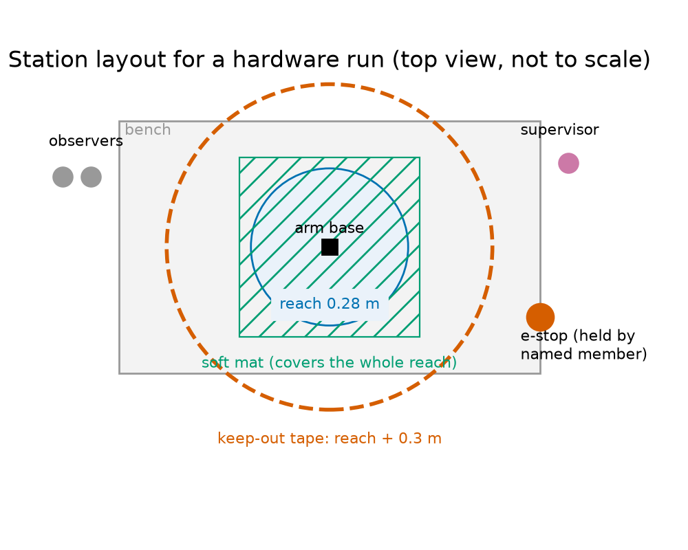
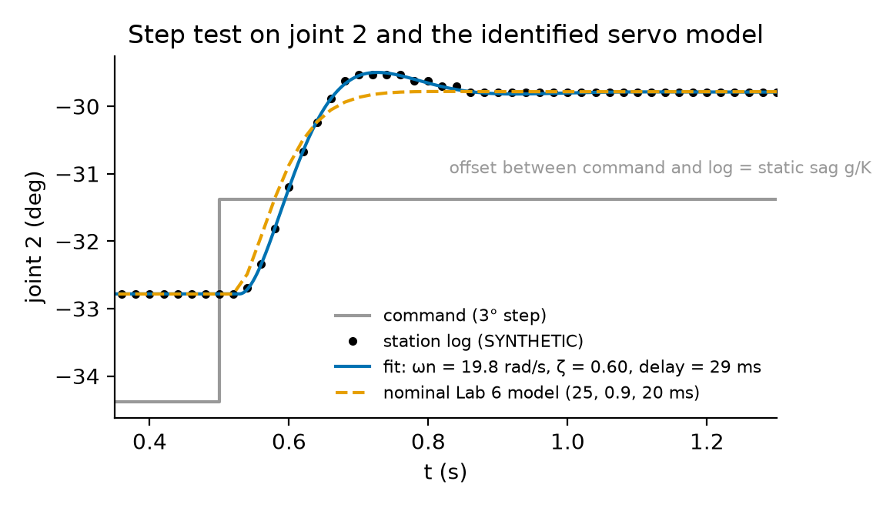
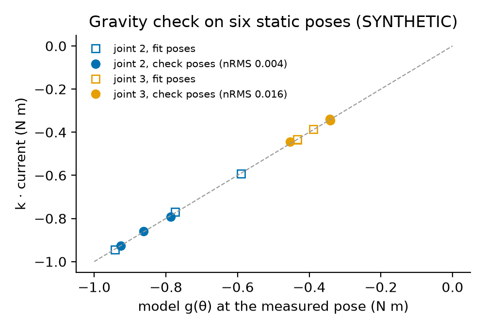
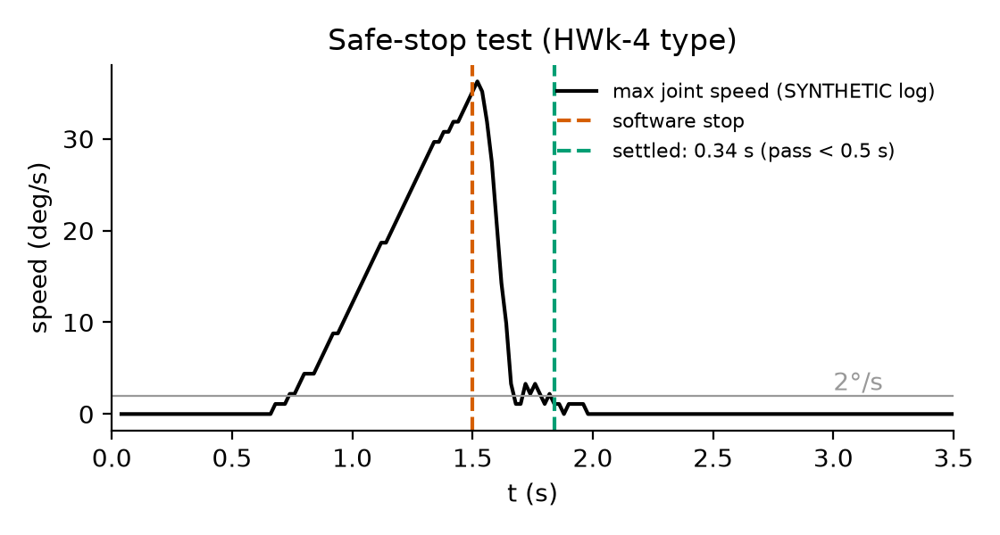

# Overview

| Item | Detail |
|---|---|
| Session | Session 4 (50 min): 12 min project safety induction (course arm and haptic device) for everyone, then a rotation between the arm stations (supervised) and the Tier 0 analysis bench. Finish the analysis at home (up to 2 h, due before the Week 9 lab). |
| CLOs | **461-8** (build and run a system on hardware; first step of the project hardware run); 461-4 (a trajectory that respects speed, acceleration and torque limits); 461-2 (verified dynamics code, RNEA in the dry run) |
| Files | `lab/starter.py` (you edit), `lab/test_lab.py` (auto-checks), `lab/course_arm.py` (the lab's own copy of the course-arm model, numbers identical to Course resources: *Course robot models and hardware safety checklist*), `lab/data/rotation1_task.json` (task), `lab/data/session_record_template.json`, four **synthetic** station logs for the simulation fallback (`traj_log.csv`, `step_log.csv`, `static_log.csv`, `stop_log.csv`) |
| Reference | `modern_robotics` (`InverseDynamics`); the project starter `sbeg461_project/hardware.py` (same log format and metrics); Lab 6 (`check_command`, `tracking_metrics`) |
| Reading | Project brief §5.1–5.2; MR §8.9.2, printed pp. 311–313 (apparent inertia, why the servo is stiff); Åström–Murray §6.3, pp. 183–185 (second-order step response, Table 6.1); Corke §9.4.2, pp. 204–211 (independent joint control) |
| Assessment | Auto-checked (`test_lab.py`) + the signed induction sheet + the filled session record + a short results table and reflection. It counts as one auto-checked lab in the Labs component (Course syllabus §4 Assessment); it is not a formal report. **The signed induction is required before any project hardware session** (brief §5.2, rules A5 and B1). |
| AI use | Allowed with disclosure for the code (see Reflection). Not allowed for the induction quiz. |
| Tier | 0 (simulation, synthetic logs) for everyone; Tier 1 (course arm) as a supervised station run. Every part can be completed in Tier 0. |

**Where today's induction fits.** You completed the course-arm induction in SBEG 361. The Week 6 lab began with a short
refresher of the course-arm checklist and the haptic-device induction, and the Lab 6 trajectory run that followed was
TA-supervised under the same checklist. Today is the **full project induction for both devices** (course arm and
Hapkit-type haptic device). It is signed, and it is required before any project hardware session (rules A5 and B1 of
brief §5.2). Today's run is practice: the hardware part of the project is complete only after your team's **two
supervised project sessions** in Weeks 10–13 (brief §5.3, project rubric).

Your functions go into your `sbeg461_dynamics` library as `hwrun.py`. You will use them again in the two project
hardware sessions (Weeks 10–13): project session 1 is bring-up, calibration and identification, which is exactly what
you rehearse today. `hwrun.py` reuses the Lab 5 quintic, the Lab 6 command check and the RNEA of Labs 2–4.

**Application context.**
*Biomedical:* the test motion is the Lab 6 patient-positioning mock-up: the course arm carries a 0.1 kg foam phantom
from a tray, over a clearance waypoint, to a pose above a mock couch, and back. A positioning robot near a patient must
be checked in exactly this order: plan, check, dry-run, slow first run, then compare with the model.
*Defence (protective and humanitarian):* the same bring-up procedure applies to an EOD manipulator before it handles a
suspect object, or to a casualty-handling arm before it touches a person. Its parts are a supervised first motion at
reduced speed, an e-stop held by a named person, a keep-out zone, and logging of every run and fault.
All robot and servo data are **illustrative values** (see Course resources: *Course robot models and hardware safety
checklist*), not the data of a product.

# Learning objectives

By the end of the session you can:

1. Explain what a hardware run on a position-controlled arm tests, and what it does not test.
2. Apply the hardware safety checklist of project brief §5.2 (rules A1–A7 and B1–B6) and fill in a session record that passes `preflight`.
3. Build a rest-to-rest quintic command through waypoints at first-run limits, check it, and predict its peak
   speed and torque with the RNEA (dry run).
4. Identify a servo model ($\omega_n$, $\zeta$, delay) from a step response, by hand and by least squares.
5. Use static poses to fit a torque constant and a loop stiffness, and run a gravity check (normalised RMS).
6. Compare a measured run with the nominal and the identified simulation, quantify the model error, and measure a
   safe-stop time.

# Pre-lab check (complete before the session; 5 questions)

1. The course arm's servos are position-controlled. Which of these does a hardware run on it test: (a) your
   kinematics and joint-angle conventions, (b) your time scaling, (c) your computed-torque controller, (d) your dynamic
   model, through the predicted torques compared with measured currents?
2. The rated joint speed is 160°/s. What speed limit (rad/s) applies to a first run of a new motion, and what to a
   repeated motion (brief §5.2, rule A3)?
3. A quintic rest-to-rest move of 0.9 rad must respect $|\dot q| \le 0.698$ rad/s and $|\ddot q| \le 2$ rad/s². Using the
   quintic peaks $\frac{15}{8}\frac{\Delta}{T}$ and $\frac{10}{\sqrt3}\frac{\Delta}{T^2}$, find the shortest $T$.
4. A step response overshoots by 9.5 % and peaks 0.20 s after the motion starts. Estimate $\zeta$ and $\omega_n$
   (Åström–Murray Table 6.1).
5. Name four items of the safety checklist that must be true **before** the arm is powered.

*Answers (for self-check):* 1. (a), (b) and (d). Not (c): the servo closes its own position loop, so no torque
controller of yours runs on the arm (brief §5.1). 2. $0.25\times160° = 40°/\text{s} = 0.698$ rad/s; $0.5\times160° = 80°/\text{s} =
1.396$ rad/s. 3. Speed: $T \ge 1.875\times0.9/0.698 = 2.417$ s. Acceleration: $T \ge \sqrt{5.774\times0.9/2} = 1.612$ s.
So $T = 2.417$ s, rounded up to $2.42$ s on the 20 ms servo grid. 4. $\zeta = -\ln0.095/\sqrt{\pi^2 + \ln^2 0.095} = 0.600$,
$\omega_n = \pi/(0.20\sqrt{1 - \zeta^2}) = 19.6$ rad/s. 5. Any four of: signed induction for everyone at the arm (A5);
supervisor present and e-stop tested (A7); e-stop held by a named member (B4); keep-out zone taped and clear (A2, A6);
workspace ready, i.e. mat, payload fixed, cables tidy (B5); payload ≤ 0.125 kg (A4); command checked at the right speed
fraction (A3) with a ≥ 10° joint-limit margin (A1); dry-run prediction on the log (B2); servo current limit ≤ 60 %.

# Setup

```bash
cd "<your Lab code folder>"          # or your Classroom 50 repo
python -c "import numpy, scipy, modern_robotics; print('ok')"
LAB_IMPL=starter python -m pytest -q test_lab.py   # expected: 13 failed, 2 passed, 3 errors (NotImplementedError)
```

On Windows (PowerShell) use `$env:LAB_IMPL="starter"; python -m pytest -q test_lab.py`. The provided parts of
`starter.py` are `course_arm_model`, `inverse_dynamics`, `gravity_torques`, `load_task`, `write_log`, `load_log`,
`simulate_servo` (servo model with zero-order hold, delay, optional sag and encoder), `check_command` and
`tracking_metrics` (from Lab 6), `average_approaches` and `step_response`. You write the 15 functions marked TODO.

# The rotation (50 min)

| Time | Everyone | Arm stations (up to 4, one team each, TA present) |
|---|---|---|
| 0–12 | **Project safety induction** for both devices (briefing at a demonstration station, see below), induction quiz, signatures | Demonstration: e-stop test, keep-out zone, homing |
| 12–50 | Tier 0 bench: Parts A–D on the synthetic logs, in your team | Each team in turn, **about 10 min per team**: pre-flight (Part A), first run of the test motion, step test, two static poses, software stop |

Teams that are not at a station work on Parts A–D. If your team gets no slot, the synthetic logs are your data (the
simulation fallback). Everyone takes the haptic-device part of the induction, because rule B1 names this Week 8
induction for the haptic device. Scenario 1 and 6 teams run the arm today like everyone else.

## Project safety induction (12 min, required, signed)

The induction covers the whole hardware safety checklist of project brief §5.2: rules **A1–A7** for the course arm (quoted
from the shared course-arm checklist in Course resources: *Course robot models and hardware safety checklist*) and the session
rules **B1–B6** for both devices. You sign this list. Every rule has a reason, and you must be able to state it.

| Rule (brief §5.2) | What you sign | Why |
|---|---|---|
| A5, B1 | Everyone who touches the course arm or the haptic device has completed and signed this induction | The rules only protect people who know them |
| A7, B1 | The e-stop (or stop button) is tested at the start; a TA or the instructor supervises the whole session; never run hardware alone | Someone who is not busy with the laptop watches the device |
| B2 | Dry run: the exact command file runs in simulation first; the predicted peak speed and torque (or force, current) are written on the session log | A plan that is wrong in simulation is wrong on the arm. Writing the numbers down makes you compare them afterwards |
| A1 | Software joint limits at least 10° inside the hardware limits (≤ ±155°, J6 ≤ ±165°) | A wrong offset or overshoot stops in software before it reaches the end stop |
| A3 | Joint speed ≤ 25 % of rated (≤ 40 °/s) on the first run of any new motion; ≤ 50 % (≤ 80 °/s) otherwise | Reaction time for the e-stop holder, and margin for model error (Paper A Q5(g): derating with gravity) |
| A4 | Payload ≤ 50 % of the rated 0.25 kg, i.e. **≤ 0.125 kg**, unless the department approves an exception | Margin for the servo torques and for a payload error that the model does not know (Part C) |
| (A, current) | Servo current limit ≤ 60 % of rated, set **in the servo firmware** | The firmware limit acts even if your code is wrong |
| B4 | The e-stop (power cut-off) is within reach of a named member who holds it during every motion | The person at the laptop is looking at the screen, not at the arm |
| A2, A6 | Keep-out zone of reach + 0.3 m ≈ 0.58 m, taped; nobody inside while the arm can move; a hand may enter for a measurement only with the arm in latched stop and torque disabled (or power removed), with the safety officer's approval | A servo fault or a wrong offset can move a joint at full speed |
| B5 | Workspace: cables tidy, no loose clothing or hair, no faces at arm height, payload fixed, mock obstacles fixed, soft mat under the workspace | Smart servos **drop** the arm when power is cut |
| B3 | Haptic device: handle force saturated at 2 N in the firmware; watchdog sets the motor output to zero if the handle leaves ±40 mm or the loop overruns; only the operator's hand on the handle | Your own controller runs on this device, so the firmware must catch its errors |
| B6 | Logging: every run is logged (CSV); faults go on the session log with time, unit number and symptom; the supervisor initials it | Faults that are not written down cannot be fixed or excused (brief §5.5) |



**Stop immediately** (e-stop) on any unexpected motion, noise, contact, smell of overheating or a wrong first pose.
Do not restart until the TA has checked the arm. **E-stop vs software stop.** The e-stop cuts power: the arm drops
onto the mat, which is why the mat is required. The software stop freezes the command, so the servos hold the
current pose (Part D measures how fast). Use the e-stop whenever in doubt.

**Haptic device (rule B3, demonstrated on a device at the station).** The 2 N saturation and the ±40 mm / loop-overrun
watchdog are in the firmware, so they act whatever your controller does. Your own impedance controller runs on the device in
Week 12 (Lab 11) and in the project (Scenarios 1 and 6).

**Induction quiz** (on paper, no AI, 3 questions, all must be correct; the TA marks it on the spot): (1) What do you do if
the arm moves towards an unexpected pose at the first waypoint? (2) Why must the mat be under the workspace? (3) Who may
be inside the tape while the arm can move? *(Answers: e-stop, tell the TA, write the fault on the log; servos drop
the arm on power loss; nobody; a hand may enter for a measurement only with the arm in latched stop and torque disabled (or power removed),
with the safety officer's approval.)*

# Procedure

## Part A — Pre-flight: units, the command file and the dry run (15 min)

1. Implement `servo_to_model` and `model_to_servo`. The servos report degrees from their own zero:
   $q_{\text{model}} = q_{\text{servo}} - \text{offset}$, i.e. the model angle is the servo reading minus that unit's zero
   offset (both in degrees, then converted to radians), and `model_to_servo` adds the offset back. The station offsets
   are in the task file (illustrative, for unit 3; use **your unit's** values at the station).
2. Implement `segment_time` and `waypoint_command`. Use a rest-to-rest **quintic** (Lab 5, MR §9.2.2.1, p. 332) between
   consecutive waypoints, synchronised so that all joints start and stop together. Add a dwell of 0.5 s at each waypoint
   and sample every 20 ms. First-run limits: $|\dot q_j| \le 0.25\times160°/\text{s}$, $|\ddot q_j| \le 2$ rad/s².
   Rotation 1 is stricter than the 4 rad/s² of Lab 6 because it is the first motion on a physical unit whose servo
   response has not been identified yet (Part B does that), and halving the acceleration halves the inertial torque; it
   costs no time here, since all three segments are speed-limited (Checkpoint A). The other limits are quoted from the
   shared course-arm safety checklist (Course resources: *Course robot models and hardware safety checklist*, the single
   source; brief §5.2 quotes it as A1–A7): joint speed ≤ 25 % of rated (≤ 40 °/s) on the first run of any new motion and
   ≤ 50 % (≤ 80 °/s) otherwise (A3), payload ≤ 50 % of the rated 0.25 kg, i.e. ≤ 0.125 kg (A4), and servo current ≤ 60 %
   of rated.
3. Implement `dry_run`: the RNEA torques along the command with the 0.1 kg phantom (MR Eqs. 8.50–8.54 through
   `inverse_dynamics`), and the peak speed and torque ratios against 25 % rated speed and 60 % rated torque.
4. Fill in `data/session_record_template.json` for your team (save it as `session_record.json`), including the weighed
   payload in kg (today 0.1 kg; rule A4 allows at most 0.125 kg). Implement `preflight` and run it on your record. It must return an empty list before the TA lets you power the arm.

**Checkpoint A.** Segment times $2.42$, $1.62$, $4.04$ s (all three are speed-limited: the raw bounds are
$2.417 / 1.612$, $1.611 / 1.316$ and $4.029 / 2.081$ s for speed / acceleration). The command has 505 samples and lasts 10.08 s.
`check_command(t, q, model, 0.25, 10)` passes with a peak speed ratio of $0.9988$. The dry run gives peak torques
$(0.026, 0.892, 0.383, 0.130, 0.002, 0.000)$ N m: joint 2 uses $0.495$ of the 60 % torque budget, and joint 1 uses $0.999$ of the
speed budget. On this light arm the **speed** limit decides, as in Lab 6. The first waypoint in servo degrees is
$(1.5, -36.38, 80.71, -137.51, -90.95, 0.0)$. Compare it with the station's display before the first motion.
`pytest -q -k "conversion or segment or waypoint or dry_run or preflight"` passes.

## Part B — Step test and servo identification (10 min)

At the station the TA runs a **3° step** on joint 2 and then on joint 3, from the tray pose. The predicted peak speed of a
3° step is about 0.52 rad/s, inside the 25 % limit (checked by the course team). Use `data/step_log.csv` (synthetic)
or your own log. The windows of the two steps are in `task["step_test"]["windows_s"]`.

5. Implement `zeta_wn_from_step` (Åström–Murray Table 6.1, p. 185) and `step_features` (step time, overshoot, peak
   time, a rough start of motion).
6. Implement `identify_servo`: least squares on $y(t) = y_0 + A\,h(t - t_{\text{step}} - d;\ \omega_n, \zeta)$, where $h$ is the unit step
   response (`step_response`). Solve $y_0$ and $A$ linearly inside the residual and fit $(\omega_n, \zeta, d)$ with
   `scipy.optimize.least_squares`. Start from the hand estimate.

**Checkpoint B.** Overshoot $8.8$ % (joint 2) and $9.1$ % (joint 3). The fit gives $\omega_n = 19.75$, $\zeta = 0.595$,
$d = 28.8$ ms (joint 2) and $19.98$, $0.602$, $29.7$ ms (joint 3), with a residual RMS below $3\times10^{-4}$ rad. The
mean is $(19.87\ \text{rad/s},\ 0.599,\ 29.3\ \text{ms})$. The Lab 6 nominal model was $(25, 0.9, 20\ \text{ms})$. The hand estimate
from the sampled log is rough ($\omega_n \approx 27$ rad/s): at 50 Hz the peak time and the start of motion are only known
to ±20 ms. Say in one sentence why the least-squares fit is better.



## Part C — Static poses: gravity check, torque constant, loop stiffness (10 min)

At the station the TA moves the arm to two of the six static poses of the task file. Each pose is approached from below
and from above, and the station software records the settled position and current. The synthetic `static_log.csv` has
all six poses.

7. Implement `torque_constant`, `normalised_rms` and `loop_stiffness` (same definitions as the project's `hardware.py`).
8. Implement `gravity_check`. Average the two approaches (`average_approaches`, which cancels static friction to first
   order). Compute $g(\theta)$ at the **measured** pose with the RNEA. Fit $k_j$ on poses 1, 3, 5 and check it on poses 2,
   4, 6. Fit the loop stiffness $K_j$ from the sag $q_{\text{cmd}} - q_{\text{meas}} \approx g_j/K_j$.

**Checkpoint C.** Joints 2–4: $k = (1.184, 1.164, 0.449)$ N m/A, nRMS on the check poses $(0.004, 0.016, 0.006)$, all
far below the project threshold of 0.3. Loop stiffness $K = (28.7, 13.9, 5.36)$ N m/rad. The sag of joint 2 at the tray
pose is about $0.787/28.7 = 0.0275$ rad, i.e. **1.6°**. That alone is larger than the sim-vs-hardware budget of 1° RMS
per joint in HW3-2 (scenario sheets) if your simulation ignores it. **Pitfall:** the torque constant absorbs any error that is proportional to $g$. The synthetic unit
carries 20 g more than the model (clip and cable), so $k$ comes out 5–7 % low, and the gravity check still passes.
This is why the project test HW2-2(c) repeats the run with a known 100 g clip mass.

## Part D — Simulation versus hardware, and the safe stop (10 min)

9. Implement `compare_runs` (project brief §5.4: commanded-vs-measured and simulated-vs-measured RMS and maximum
   errors, and the lag).
10. Compare the measured test motion (`traj_log.csv` or your log) with two simulations of the **same command**:
    the nominal Lab 6 servo (`simulate_servo(t, cmd, **NOMINAL_SERVO)`) and your identified model, i.e. the mean
    $(\omega_n, \zeta, d)$ of Part B plus the sag with your $K$ of Part C (use a very large $K$ for joints 1, 5, 6).
11. Optional: the normalised RMS of the dry-run torques (Part A) against $k_j\times$ current during the motion, for joints 2 and 3.
12. Implement `stop_time`. Measure the time from the software stop (`stop_log.csv`, trigger at 1.5 s) until every joint
    is slower than 2°/s.

**Checkpoint D.**

| Quantity (rad unless stated) | J1 | J2 | J3 | J4 |
|---|---|---|---|---|
| RMS(cmd − meas) | 0.0395 | 0.0329 | 0.0332 | 0.0242 |
| RMS(nominal sim − meas) | 0.0013 | 0.0282 | 0.0261 | 0.0243 |
| RMS(identified sim − meas) | 0.0004 | 0.0006 | 0.0003 | 0.0002 |

The lag is $0.10$ s. It matches $2\zeta/\omega_n + d + \Delta t/2 = 0.060 + 0.029 + 0.010$ s: the ramp-following error of a
second-order loop, the delay, and half a sample of zero-order hold. For joints 2–4 the nominal model is wrong mainly
because it has **no sag**. The identified model is within about 1 encoder count. Motion-torque nRMS: $0.05$ (J2),
$0.09$ (J3). Stop time $0.34$ s, below the 0.5 s of the project tests. `pytest -q` passes completely.






# At the station (team procedure, about 10 min)

1. Show the TA your `session_record.json` with `preflight(...) == []`, and the dry-run numbers written on the
   printed session log. Members who touch the arm show their signed induction.
2. The TA powers the arm and tests the e-stop. The named holder takes the e-stop. Everyone else stays outside the tape.
3. Homing: the station routine moves the arm slowly to the first waypoint. Check the pose against your servo-degree
   values from Part A **before** the first motion.
4. Run the test motion once at first-run limits (25 %). Then the TA runs the 3° steps, two static poses and the software
   stop. The logger writes `t, cmd_1..6, meas_1..6, cur_1..6`.
5. Copy the logs, write any fault on the session log, and have the TA initial it.

If the arm fails or the slot is lost, the fault is recorded and your team uses the synthetic logs. This is the
simulation fallback, and it carries no penalty in this lab.

<!-- library-block:begin -->
# Your `sbeg461_dynamics` library

When the tests pass, copy the functions you wrote in Hardware rotation 1 into your cumulative library as `hwrun.py`. The functions you write (15):

`servo_to_model(q_servo_deg, offset_deg)`, `model_to_servo(q_model, offset_deg)`, `segment_time(delta, v_max, a_max, dt: float=DT)`, `waypoint_command(waypoints, v_max, a_max, dt: float=DT, dwell: float=0.5)`, `dry_run(model: dict, cmd: dict, speed_fraction: float=0.25, torque_fraction: float=0.6)`, `zeta_wn_from_step(overshoot: float, t_peak: float)`, `step_features(t, cmd, meas, threshold: float=0.1)`, `identify_servo(t, cmd, meas, window: float=1.0)`, `torque_constant(current, tau_model)`, `normalised_rms(predicted, measured)`, `loop_stiffness(sag, tau_model)`, `gravity_check(static: dict, model: dict, joints=(1, 2, 3), fit=(0, 2, 4), check=(1, 3, 5))`, `compare_runs(t, cmd, meas, sim, skip: float=0.0)`, `stop_time(t, q, t_trigger: float, threshold: float=np.deg2rad(2.0), window: float=0.1)`, `preflight(record: dict)`.

Names shared with other labs:

* The provided `check_command` and `tracking_metrics` are Lab 6's functions, unchanged (same signatures).
* The provided `simulate_servo` extends Lab 6's: it adds `stiffness` and `model` **before** `enc_res`, so pass `enc_res` by keyword (`enc_res=...`) when you call either version.

The provided helpers at the top of `starter.py` (loaders, plotting, simulators) do not have to go into the library. The full list of library functions of all labs is in the Week 13 lab handout.
<!-- library-block:end -->

# Deliverables (upload to the course site before the Week 9 lab)

1. `starter.py` passing `LAB_IMPL=starter python -m pytest -q test_lab.py` (all tests).
2. Your `session_record.json` (passes `preflight`) and a photo or scan of the signed induction sheet and the initialled
   session log.
3. A results table with the values of Checkpoints A–D for **your** data (station log, or synthetic if you had no slot).
   Label every number "measured" or "synthetic".
4. Two figures: the step fit (Part B) and the sim-vs-hardware overlay of joint 2 (Part D). Use labelled axes and units,
   and put "measured" or "synthetic" in the title.
5. Reflection (≤ 1 page, below).

# Reflection (≤ 1 page)

1. Which result of today would you trust on the real arm, and which not? Name two sources of model error and give a
   number for each (for example the sag, the lag, the payload error hidden in $k$).
2. The project hardware tests allow an RMS difference between simulation and measurement of about 1–1.5° per joint
   (HW2-2, HW3-2). Would the nominal servo model meet it on today's data? What must your project simulation contain
   (identified loop, delay, sag), and what would you change in the plan (slower motion, an offset for the sag)?
3. Which rule of the safety checklist (A1–A7, B1–B6) would you have skipped if no one had checked it? Why is it there?
4. Ethics prompt (short): in a real patient-positioning or casualty-handling robot, who should hold the e-stop, and
   who decides that a fault is "fixed"?
5. **AI-use note** (required, Course syllabus §8 AI-use policy): name the tool(s), the prompts or questions, and what you kept or rejected. You must
   be able to explain every line of `identify_servo` and `gravity_check` in the oral check.

# Troubleshooting

| Symptom | Likely cause and fix |
|---|---|
| `check_command` fails with `starts_at_rest = False` | No dwell at the start, or the first segment begins with a non-zero step. Start with `dwell` samples at the first waypoint. |
| Peak speed ratio slightly above 1 | You did not round $T$ **up** to the 20 ms grid, or you used the cubic peak $1.5\Delta/T$ instead of the quintic's $1.875\Delta/T$. |
| Dry-run torques differ from the test by a constant | Gravity off, or payload not added (`course_arm_model(0.1)`). |
| Station arm goes to a strange pose at homing | Wrong servo offset or degrees vs radians. **E-stop**, tell the TA, compare the first row of your command with Part A. |
| `identify_servo` returns $\zeta$ at a bound or a delay of 0 | Window too short, or both steps in one window. Use the windows in the task file and check that `cmd` has exactly one step. |
| Fitted $\omega_n$ far from the hand estimate | Expected with 50 Hz data (see Checkpoint B). Plot the fit over the samples; trust the fit if it passes through them. |
| $k$ negative or nRMS ≈ 1 | Current column of the wrong joint, or $g$ evaluated at the commanded instead of the measured pose with a sign error. Plot $k\,i$ against $g$. |
| `stop_time` returns `inf` | The log ends before the arm settles, or the speed estimate is noisy: use the 0.1 s window. |
| `ModuleNotFoundError: course_arm` | Run pytest from inside `lab/`. |

# C++ track

You may do the code of this lab in C++17 instead of Python. The functions, data files, checkpoints, station procedure
and deliverables are the same (deliverable 1 is `cpp/starter.cpp` with all 16 C++ test cases passing, instead of
`starter.py`); the auto-checks compare your results with `mrcpp` (the C++ port of `modern_robotics`
in the course folder `cpp_support`: `inverse_dynamics`), with the closed forms and synthetic signals of the Python
tests, with the synthetic station logs in `data/` and with the numbers of the Python reference, so both tracks are
marked against identical values. The session record is the same JSON file (`session_record.json`), and your C++
`preflight` reads it with `sbeg::load_json`.

**Files** (in the `cpp` sub-folder of your Lab code folder): `starter.cpp` (your work), `lab.hpp` (declarations and
documentation — do not change), `test_lab.cpp` (auto-checks, doctest), `cpp_cases.json` (reference numbers),
`CMakeLists.txt`, and given code you do not edit: `course_arm.cpp` (C++ copy of `course_arm.py`, same numbers) and
`helpers.cpp` (the provided part of `starter.py`). The data files are the same files in `data/`. `cpp_support`
(Course resources) must sit next to your lab folders or in a parent folder of them (the build finds it automatically
up to 6 levels up).

**Requirements.** A C++17 compiler — Windows: Visual Studio Build Tools (2022 or 2026), workload "Desktop development with
C++"; macOS: `xcode-select --install`; Ubuntu: `sudo apt install build-essential`. CMake and Ninja come with
`pip install cmake ninja` (both are in the course `requirements.txt`).

**Build and run** (from your Lab code folder):

```bash
python run_lab.py hw1 --cpp                    # configure, build, run, print Score: k/n
# or directly:
cmake -S cpp -B build -G Ninja
cmake --build build
./build/lab_tests                              # Windows: build\lab_tests.exe
./build/lab_tests -tc="*segment*,*waypoint*"   # only some tests (like pytest -k)
```

With the untouched starter, the program builds and all 16 test cases fail with `TODO: <function>`: this is
expected. Rebuild (`cmake --build build`) after every change.

**Functions to write** (in `starter.cpp`, the same 15 functions and order as in Python): `servo_to_model`,
`model_to_servo`, `segment_time`, `waypoint_command`, `dry_run` (Part A); `zeta_wn_from_step`, `step_features`,
`identify_servo` (Part B); `torque_constant`, `normalised_rms`, `loop_stiffness`, `gravity_check` (Part C);
`compare_runs`, `stop_time`, `preflight` (Part D). Given and complete, as in `starter.py`: `course_arm_model`,
`inverse_dynamics`, `gravity_torques` (one pose) and `gravity_torques_rows` (one pose per row), `load_task`,
`data_path`, `write_log`, `load_log`, `simulate_servo`, `check_command`, `tracking_metrics`, `average_approaches`,
`step_response`, plus two replacements for NumPy/SciPy: `median` (= `np.median`) and `least_squares` (a bounded
Levenberg–Marquardt solver that replaces `scipy.optimize.least_squares` in `identify_servo`). The constants `DT`,
`ENC_RES`, `QUINTIC_V`, `QUINTIC_A`, `NOMINAL_SERVO`, `PAYLOAD_MAX_KG` and `PREFLIGHT_RULES` are in `lab.hpp`.

**Checkpoints** (16 C++ test cases with the Python test names; the Python track counts 18 tests: its two tests that
check only provided helpers — `step_response` against the servo simulator, and the 10° margin of `check_command` —
pass from the start in Python and are checked inside `test_step_features_synthetic` and
`test_command_passes_first_run_check` in C++).
A: `./build/lab_tests -tc="*conversion*,*segment*,*waypoint*,*first_run*,*dry_run*,*preflight*"` (6 test cases);
B: `-tc="*zeta*,*step_features*,*identify_servo*"` (4); C: `-tc="*torque_constant*,*loop_stiffness*,*gravity_check*"`
(3); D: `-tc="*compare_runs*,*identified_model*,*stop_time*"` (3, `preflight` is counted in A); finally
`./build/lab_tests` must show 16 passed.

**Differences from the Python version.**

| Python | C++ |
|---|---|
| a `dict` result (`cmd["seg_T"]`, `d["ok"]`, `r["wn"]`) | a small struct with the same field names, declared in `lab.hpp`: `WaypointCommand`, `DryRun`, `StepFeatures`, `ServoFit`, `GravityCheck`, `RunComparison` (`cmd.seg_T`, `d.ok`, `r.wn`) |
| `model` dict (`model["Mlist"]`, `model["tau_max"]`) | `lab::Model` with the same field names (`model.Mlist`, `model.tau_max`); `limits` is $6\times2$ |
| `waypoints` list of lists; `q`, `qd`, logs as `(N, n)` arrays | `Eigen::MatrixXd` with one row per waypoint / sample; `t` is an `Eigen::VectorXd` |
| `v_max`, `a_max` scalar or array | `Eigen::VectorXd` with $n$ entries: pass `Eigen::VectorXd::Constant(n, 2.0)` for a scalar limit |
| `zeta_wn_from_step` returns `(zeta, wn)` | `std::pair<double, double>`: `auto [zeta, wn] = lab::zeta_wn_from_step(Mp, tp);` |
| `load_log(path)` dict with `t`, `cmd`, `meas`, `cur` (or `None`), extra columns | struct `lab::Log`; an absent group is an empty ($0\times0$) matrix; extra columns in `log.extra` (`log.extra.at("pose")`); `load_log(lab::data_path("step_log.csv"))` |
| `gravity_torques(model, q)` with `q` of shape `(N, n)` | `gravity_torques_rows(model, Q)` |
| `simulate_servo(t, cmd, **NOMINAL_SERVO)`; `stiffness=K, model=model` | `simulate_servo(t, cmd, NOMINAL_SERVO.wn, NOMINAL_SERVO.zeta, NOMINAL_SERVO.delay)`; `simulate_servo(t, cmd, wn, zeta, delay, K, &model)`; `wn`, `zeta`, `delay` are scalars |
| `scipy.optimize.least_squares(fun, x0, bounds=(lb, ub), x_scale=...)` | given `lab::least_squares(fun, x0, lb, ub, x_scale)` with `fun` a lambda returning the residual `Eigen::VectorXd`; the result has `x` and `cost` |
| `np.linalg.lstsq(X, y)` ($m\times2$) | `X.colPivHouseholderQr().solve(y)` |
| `joints=(1, 2, 3)`, `fit=(0, 2, 4)` (0-based); `x[fit]` | `std::vector<int>{1, 2, 3}`; copy the selected entries in a loop |
| `np.median`, `np.inf` | given `lab::median(v)`; `std::numeric_limits<double>::infinity()` (`<limits>`) |
| `preflight(record: dict)`; `json.load` | `preflight(const sbeg::json& record)`; `sbeg::load_json(path)`; `record.contains("key")`, `.is_null()`, `.is_boolean()`, `.get<double>()` |
| figures with matplotlib | write CSV files (`lab::write_log` or `sbeg::write_csv`) and plot them in Python (see below) |

A matrix-size mistake (e.g. subtracting a row from a matrix without `.rowwise()`) does not crash the test program:
it is reported as a failed test with the message "Eigen: wrong matrix size or index out of range".

**Figures for the deliverables.** The plots stay outside the auto-checks. Write a small program that saves the step
fit and the sim-vs-hardware data as CSV files (`lab::write_log(path, t, cmd, meas)` writes the station log format,
`sbeg::write_csv(path, header, matrix)` any table), and plot them with Python/matplotlib or another tool. To build
such a program, add these lines at the end of `cpp/CMakeLists.txt` (below `sbeg_lab(...)`) and write
`cpp/experiments.cpp` with a `main()`:

```cmake
add_executable(experiments experiments.cpp starter.cpp course_arm.cpp helpers.cpp)
target_link_libraries(experiments PRIVATE sbeg_mrcpp)
target_compile_definitions(experiments PRIVATE "SBEG_LAB_DIR=\"${CMAKE_CURRENT_SOURCE_DIR}\"")
```

**C++ troubleshooting.**

| Symptom | Likely cause | Fix |
|---|---|---|
| `cpp_support not found` | the course folder `cpp_support` is not next to / above your Lab code folder | copy it there, or configure with `-DSBEG_CPP_SUPPORT=<path>` |
| `No CMAKE_CXX_COMPILER could be found` | no C++ compiler installed | install it (see Requirements); on Windows run from the "x64 Native Tools Command Prompt" if Ninja cannot find `cl` |
| `cannot open file: .../cpp_cases.json` or `.../data/...` | Lab code folder moved after configuring | delete the `build` folder and configure again |
| `waypoint_command` test stops at `REQUIRE(c.t.size() == 505)` | final dwell without the extra sample, or `T / dt` truncated instead of rounded | the final dwell has `nd + 1` samples; use `std::nearbyint` |
| `segment_time` gives 2.40 instead of 2.42 | rounded to the nearest sample instead of UP | `std::ceil(T / dt - 1e-9) * dt` |
| `identify_servo` far off or at a bound | residual of the wrong length, window not applied, or `x_scale` forgotten | the residual has one entry per sample of the window; pass `x_scale = (10, 0.1, 0.01)` |
| `preflight` test: a rule fails on the good record | a number read with `get<int>()`, or `first_run` missing treated as a repeat run | read numbers with `get<double>()`; only `"first_run": false` means a repeat run |
| Results wrong only in some entries, no compile error | an Eigen product stored in `auto` (`auto C = A * B;` keeps references to temporaries) | write the type: `Eigen::MatrixXd C = A * B;` |
| Tests still show your old result | program not rebuilt | `cmake --build build` before `./build/lab_tests` |
